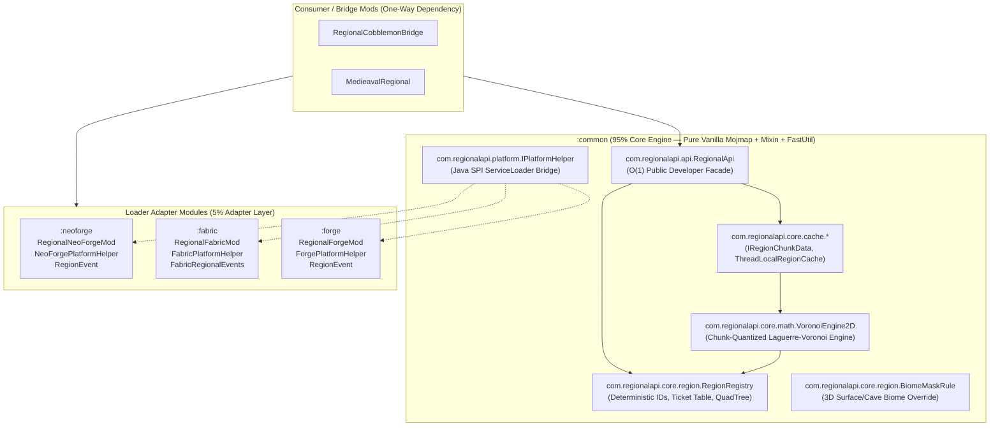
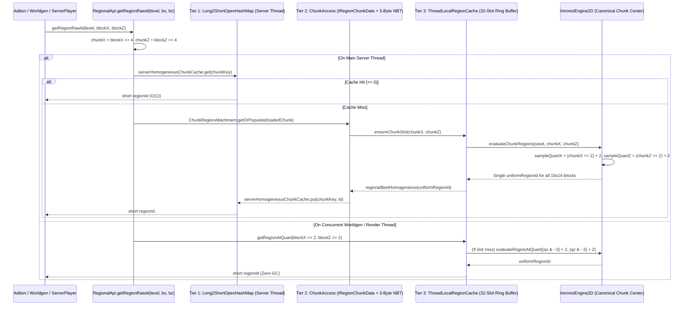

# RegionalAPI (`v1.0.9`) — Requirements, Product & Technical Design Document (RPD & Base Code Architecture)

**Mod ID**: `regionalapi`  
**Base Package**: `com.regionalapi`  
**Target Platform**: Minecraft `1.21.1` (Java 21)  
**Supported Mod Loaders**: NeoForge (`21.1.77+`), Fabric (`0.16.14+` / Fabric API `0.116.17+1.21.1`), Forge (`52.1.20+`)  
**Mappings**: Official Mojang Mappings (`Mojmap`)  
**Architecture Paradigm**: 4-Module Tri-Loader (`95% :common` / `5% Loader Adapter`), Zero External Wrapper Libraries, Data-Oriented Design (Java DOTS / FastUtil / Zero-GC)

---

## 1. Executive Summary & Product Vision (RPD)

**RegionalAPI** is a pure, high-performance procedural geopolitical world-partitioning and 3D biome-masking library engine for Minecraft 1.21.1. It divides the Minecraft world into massive, deterministic, invisible 2D territories (**Regions**) without modifying vanilla terrain heightmaps, mutating the native world seed, or adding intrusive blocks/items.

### Core Product Requirements
1. **Strict Single-Region Per Chunk Guarantee (`1 Chunk = Max 1 Region`)**:
   - Every `16x16` block chunk is guaranteed `100%` homogeneous (`isHomogeneous == true`) and belongs to **at most 1 region**.
   - Horizontal Laguerre-Voronoi evaluation is quantized to the canonical center `QuartPos` of each chunk (`(chunkX << 2) + 2, (chunkZ << 2) + 2`, i.e., block offset `(+8, +8)`), completely eliminating mid-chunk region splitting, F3 flicker, or split chunk biome overrides.
2. **Non-Destructive Salted Regional Seed**:
   - Minecraft's native world seed (`WorldGenOptions#seed()`) is strictly read-only.
   - RegionalAPI derives an isolated 64-bit salted SHA-256 regional seed (`ClientboundSyncRegionalSeedPacket.computeSaltedRegionalSeed(rawWorldSeed)`) locked via `ThreadLocalRegionCache.setAuthoritativeRegionalSeed(regionalSeed)` before world load.
3. **Weighted 2D Laguerre-Voronoi Tessellation & Unique Regions**:
   - Supports infinite repeating territories (`GenerationMode.INFINITE_TESSELLATION`) and bounded continent worlds (`GenerationMode.FINITE_CENTRALIZED` wrapping exterior chunks in `regionalapi:wilds`, ID `0`).
   - Supports macro-scale dynamic cell scaling (`voronoiCellShift` `7..13`, i.e., `512` to `32,768` blocks per cell) and one-of-a-kind `isUnique == true` regions indexed in a lock-free 2D `UniqueRegionQuadTree` and persisted in `UniqueRegionSavedData`.
4. **Optional 3D Vertical Biome Masking (`BiomeMaskRule`)**:
   - Allows regions to selectively override surface biomes, cave biomes, or both along the Y-axis using either `STATIC_Y_THRESHOLD` (with whole-section `PalettedContainer` short-circuiting in `MixinLevelChunkSection`) or `TERRAIN_FOLLOWING_DEPTH` (`sampler.depth()`).
5. **Sub-Microsecond 3-Tier Zero-GC Caching**:
   - **Tier 1 (Server Thread)**: `Long2ShortOpenHashMap` (`serverHomogeneousChunkCache`) mapping `ChunkPos.asLong(cx, cz)` to primitive `short` region IDs.
   - **Tier 2 (Chunk Duck Interface)**: `IRegionChunkData` injected into `ChunkAccess` (`MixinChunkAccess`), validated in O(1) via `regional$populatedEpoch`, and serialized in 3 bytes of chunk NBT (`MixinChunkSerializer`).
   - **Tier 3 (Worldgen Worker Threads)**: Lock-free 32-slot `ThreadLocalRegionCache` per thread eliminating redundant 2D Voronoi evaluations across the 1,536 `BiomeSource.getNoiseBiome` calls per chunk.
6. **One-Way Addon / Bridge Architecture**:
   - Consumer mods (such as `RegionalCobblemonBridge`, `MedieavalRegional`, `RegionalXaero`) depend on `RegionalAPI` to register regions, query coordinates in O(1), and subscribe to multi-loader events (`PlayerEnterRegion`, `EntitySpawnInRegion`).

---

## 2. System Architecture & Data Flow Diagrams

### 2.1 Multi-Loader 4-Module Topology


### 2.2 Strict 1-Chunk = 1-Region Evaluation & 3-Tier Cache Pipeline


---

## 3. Complete Package & Class Reference (`com.regionalapi`)

| Layer | Class / Interface | Responsibility |
| :--- | :--- | :--- |
| **Constants & Config** | `com.regionalapi.RegionalModConstants` | Defines `MOD_ID = "regionalapi"`, `MOD_NAME = "RegionalAPI"`, shared SLF4J `LOGGER`. |
| | `com.regionalapi.core.config.RegionalApiConfig` | Reads/writes `config/regionalapi.json` (`voronoiCellShift`, `generationMode`, `maxFiniteRadiusBlocks`). |
| **Public API & Events** | `com.regionalapi.api.RegionalApi` | Singleton developer facade (`getInstance()`): region registration, mode config, O(1) spatial queries. |
| | `com.regionalapi.api.event.PlayerRegionEnterCallback` | Common `@FunctionalInterface` fired when a `ServerPlayer` enters a chunk with a different region ID. |
| | `com.regionalapi.api.event.EntitySpawnInRegionCallback` | Common `@FunctionalInterface` for evaluating/cancelling entity spawns by region. |
| | `com.regionalapi.api.RegionEvent` | NeoForge & Forge event classes (`PlayerEnterRegionEvent`, `EntitySpawnInRegionEvent`). |
| | `com.regionalapi.fabric.FabricRegionalEvents` | Fabric `Event<PlayerRegionEnterCallback>` and `Event<EntitySpawnInRegionCallback>`. |
| **Math & Voronoi Engine** | `com.regionalapi.core.math.DeterministicHash` | Stateless 64-bit Stafford Variant 13 (`SplitMix64`) bit-mixer for cell hashes, jitter, and ring-buffer indexing. |
| | `com.regionalapi.core.math.VoronoiEngine2D` | 2D Laguerre-Voronoi engine quantized to canonical chunk center `QuartPos` (`(chunkX << 2) + 2`). |
| **Region & 3D Biome Core** | `com.regionalapi.core.region.RegionDefinition` | Immutable region metadata (`id`, `weight`, `selectionTicketWeight`, `isUnique`, search radii, `BiomeMaskRule`). |
| | `com.regionalapi.core.region.RegionRegistry` | Two-phase server freeze/index registry, `FALLBACK_WILDS_ID = 0`, flat ticket array, and QuadTree manager. |
| | `com.regionalapi.core.region.UniqueRegionQuadTree` | Lock-free 2D spatial QuadTree resolving `isUnique == true` region dominance and `/locate` in `< 0.05 ms`. |
| | `com.regionalapi.core.region.UniqueRegionSavedData` | Persists `isUnique == true` region anchor coordinates in Overworld `DimensionDataStorage` (`regionalapi_unique_regions.dat`). |
| | `com.regionalapi.core.region.BiomeMaskRule` | 3D vertical biome override (`STATIC_Y_THRESHOLD` & `TERRAIN_FOLLOWING_DEPTH`, Surface/Cave/Dual modes). |
| | `com.regionalapi.core.region.BiomeMaskEvaluationHelper` | Static Zero-GC helper invoked by `MixinMultiNoiseBiomeSource` and `MixinBiomeSource`. |
| **3-Tier Zero-GC Cache** | `com.regionalapi.core.cache.IRegionChunkData` | Duck Interface injected into `ChunkAccess` (`regional$isInitialized`, `regional$getSingleRegionId`, etc.). |
| | `com.regionalapi.core.cache.ChunkRegionAttachment` | Static accessor `ChunkRegionAttachment.getOrPopulate(ChunkAccess)` bridging `ThreadLocalRegionCache` to chunks. |
| | `com.regionalapi.core.cache.ThreadLocalRegionCache` | 32-slot direct-mapped per-thread ring buffer + authoritative regional seed lock + atomic `CACHE_EPOCH`. |
| | `com.regionalapi.core.cache.IPlayerRegionTracker` | Duck Interface injected into `ServerPlayer` tracking `lastRegionId`, `lastChunkX`, `lastChunkZ`. |
| **Mixins (`:common`)** | `com.regionalapi.mixin.MixinChunkAccess` | Implements `IRegionChunkData` on `ChunkAccess` with epoch validation and strict 1-region homogeneity. |
| | `com.regionalapi.mixin.MixinLevelChunk` | Copies initialized `IRegionChunkData` from `ProtoChunk` to `LevelChunk` during worldgen promotion. |
| | `com.regionalapi.mixin.MixinChunkSerializer` | Reads/writes compact 3-byte homogeneous NBT (`"regionalapi:region_data"`) and auto-upgrades legacy 33-byte tags. |
| | `com.regionalapi.mixin.MixinLevelChunkSection` | Whole-section `PalettedContainer<Holder<Biome>>` short-circuit for unconditional `STATIC_Y_THRESHOLD` rules. |
| | `com.regionalapi.mixin.MixinMultiNoiseBiomeSource` | Injects at `HEAD` of `getNoiseBiome` to apply 3D `BiomeMaskRule` before vanilla 6D climate sampling. |
| | `com.regionalapi.mixin.MixinBiomeSource` | Fallback bridge for non-`MultiNoiseBiomeSource` custom biome sources. |
| | `com.regionalapi.mixin.MixinServerPlayer` | Triggers `CommonRegionMovementTracker.onPlayerEnterChunk` strictly when crossing `16x16` chunk boundaries. |
| | `com.regionalapi.mixin.client.MixinDebugScreenOverlay` | Injects `"Region: <namespace:path>"` directly above `"Biome:"` on the F3 debug HUD. |
| **Networking, CLI & SPI** | `com.regionalapi.network.ClientboundSyncRegionalSeedPacket` | S2C `CustomPacketPayload` syncing the SHA-256 salted 64-bit regional seed to clients. |
| | `com.regionalapi.network.ClientboundSyncPlayerRegionPacket` | S2C `CustomPacketPayload` syncing the player's authoritative current region `ResourceLocation`. |
| | `com.regionalapi.command.LocateRegionCommand` | Integrates `/locate region <region_id>` with tab completion, QuadTree lookup, and ring search. |
| | `com.regionalapi.client.ClientRegionTracker` | Holds client-side `currentRegionId` and formats the F3 debug string. |
| | `com.regionalapi.platform.CommonRegionMovementTracker` | Shared chunk-boundary transition detector and `PlayerEnterRegion` dispatcher. |
| | `com.regionalapi.platform.IPlatformHelper` | Java SPI interface implemented by `NeoForgePlatformHelper`, `FabricPlatformHelper`, and `ForgePlatformHelper`. |

---

## 4. Core Base Code & Authoritative Implementation Specifications

### 4.1 Chunk-Quantized 2D Laguerre-Voronoi Math (`VoronoiEngine2D.java`)
To guarantee that a `16x16` chunk never contains more than 1 region, `VoronoiEngine2D` snaps any queried `QuartPos` coordinate `(quartX, quartZ)` to the canonical center `QuartPos` of its chunk:
```java
int sampleQuartX = (quartX & ~3) + 2;
int sampleQuartZ = (quartZ & ~3) + 2;
```
And `evaluateChunkRegions` evaluates only that single canonical center point per chunk:
```java
public static boolean evaluateChunkRegions(
        long worldSeed,
        int chunkX,
        int chunkZ,
        GenerationMode mode,
        long maxFiniteRadiusSq,
        short[] outQuartGrid
) {
    int centerQuartX = (chunkX << 2) + 2;
    int centerQuartZ = (chunkZ << 2) + 2;
    short uniformRegionId = evaluateRegionAtQuart(
            worldSeed,
            centerQuartX,
            centerQuartZ,
            mode,
            maxFiniteRadiusSq
    );
    for (int i = 0; i < 16; i++) {
        outQuartGrid[i] = uniformRegionId;
    }
    return true;
}
```
 dominance is computed in pure 64-bit integer arithmetic over the `3x3` neighborhood of Voronoi grid cells:
$$\text{Power}(P, S_i) = (\text{sampleQuartX} - x_i)^2 + (\text{sampleQuartZ} - z_i)^2 - \min(w_i^2, \text{maxBiasSq})$$

### 4.2 Two-Phase Server Lifecycle & Deterministic Registry Freezing (`RegionRegistry.java`)
To ensure initial spawn chunks never evaluate before regions are frozen (and `UniqueRegionSavedData` is safely persisted once `server.overworld()` exists), all three loaders execute a synchronized two-phase startup:
1. **Phase 1 — Pre-World-Load Freeze (`ServerAboutToStartEvent` on NeoForge/Forge, `ServerLifecycleEvents.SERVER_STARTING` on Fabric)**:
   - Computes and locks `activeSaltedRegionalSeed = ClientboundSyncRegionalSeedPacket.computeSaltedRegionalSeed(rawWorldSeed)`.
   - Calls `ThreadLocalRegionCache.setAuthoritativeRegionalSeed(activeSaltedRegionalSeed)`.
   - Calls `RegionRegistry.getInstance().freezeAndIndex(server)` to sort all registered `RegionDefinition` instances alphabetically, assign deterministic `short` IDs (`1..N`, with `0` reserved for `regionalapi:wilds`), bind `Holder<Biome>` references, build `weightedTicketTable`, and construct the initial `UniqueRegionQuadTree`.
2. **Phase 2 — Post-Level-Create SavedData Sync (`ServerStartingEvent` on NeoForge/Forge, `ServerLifecycleEvents.SERVER_STARTED` on Fabric)**:
   - Calls `RegionRegistry.getInstance().syncUniqueRegionsWithOverworld(server)` to load or persist `isUnique == true` anchor coordinates inside `overworld.getDataStorage()` (`regionalapi_unique_regions.dat`).

### 4.3 Compact 3-Byte Chunk NBT Persistence (`MixinChunkSerializer.java`)
Because every chunk is guaranteed homogeneous (`1 chunk = 1 region`), `MixinChunkSerializer` writes a compact 3-byte payload into chunk NBT under `"regionalapi:region_data"`:
- `bytes[0] = 1` (Homogeneous flag)
- `bytes[1] = (byte) ((id >>> 8) & 0xFF)` (High byte of `short` region ID)
- `bytes[2] = (byte) (id & 0xFF)` (Low byte of `short` region ID)
When loading chunks from older worlds that contain legacy 33-byte border arrays (`bytes[0] == 0`), `MixinChunkSerializer.read` automatically upgrades the chunk to the single authoritative homogeneous region ID (`chunkData.regional$setHomogeneous(expectedRegionId)`).
